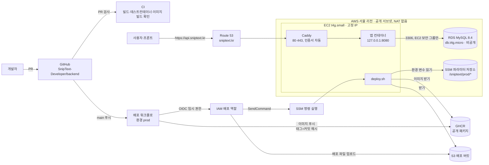
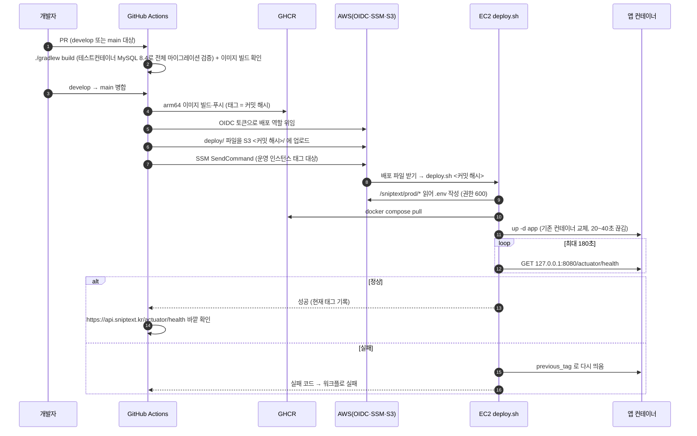

# 배포 파이프라인 설계

스닙텍 백엔드를 실제 사용자에게 내보내기 위한 배포 구조와 그 근거를 정리한다. 각 결정은 **우리 상황 → 선택지 → 고른 것 → 대가** 순서로 적는다.

- 작성일: 2026-11-11
- 범위: S1(대시보드) 출시용 운영 서버 1대
- 구현 이슈: #88 ~ #96 (마지막 절 참고)
- 비용 숫자는 모두 **추정치**다. 실제 값은 구축 시점의 AWS 가격표로 다시 확인한다.

## 1. 전제

| 항목 | 내용 |
| --- | --- |
| 서비스 | 스프링 부트 4.1(자바 21) API 서버 1개, MySQL 8.4, 플라이웨이 |
| 사용자 규모 | 출시 직후 소수. 트래픽보다 **월 비용·운영 부담**이 더 큰 제약 |
| 개발 인원 | 소수. 운영 전담 없음 |
| AWS 계정 | 무료 플랜. **2027-01-17에 닫힘** → 출시 전에 **유료 전환**한다(8절) |
| 출시 목표 | 2027-01-17 이전 |
| 도메인 | `sniptext.kr`(가비아에서 구매). 네임서버는 Route 53으로 위임. API는 `api.sniptext.kr` |
| 저장소 | `SnipText-Developer/backend`, **공개 저장소** |
| 확정 사항 | 도커 이미지 → GHCR → EC2 한 대(docker compose), 서버 1대(개발 서버 없음), 서울 리전, OIDC + SSM 명령 실행(장기 키·SSH 금지), 비밀값은 SSM 파라미터 저장소, HTTPS는 서버 안 Caddy |

## 2. 전체 구조

## 3. 배포 흐름

- **되돌리기**: 자동(상태 확인 실패 시 이전 태그)과 수동(배포 워크플로를 이전 커밋 해시로 다시 실행) 두 가지다. `latest`로는 배포하지 않는다. 어느 커밋이 서버에 있는지 항상 태그로 알 수 있어야 하기 때문이다.
- **브랜치**: `develop`은 통합 브랜치(배포 없음), `main`이 배포 브랜치다. `main`은 첫 배포 때 만든다.

## 4. 결정 기록

### 4-1. 서버: EC2 한 대 + docker compose

- **상황**: 사용자 수가 적고 비용이 가장 큰 제약. 운영 전담이 없다.
- **선택지**: EC2 + compose / ECS Fargate / Elastic Beanstalk / 쿠버네티스
- **고른 것**: EC2 **t4g.small**(ARM, 2GB) 한 대, Amazon Linux 2023, 공개 서브넷 + 고정 IP. 인스턴스 크기는 변수.
- **대가**: 서버가 죽으면 서비스가 멈춘다(자동 복구는 EC2 상태 확인 재시작 수준). 배포 중 잠깐 끊긴다. ARM이라 이미지를 arm64로 만들어야 한다 → Dockerfile 빌드 단계는 `--platform=$BUILDPLATFORM`으로 실행기에서 그대로 빌드하고 실행 단계만 arm64로 만든다(자바 바이트코드는 아키텍처와 무관). 공개 저장소라 GitHub의 ARM 실행기도 무료로 쓸 수 있다.
- t3.small(x86) 대비 같은 메모리에서 약 20% 싸다.

### 4-2. 이미지 저장소: GHCR 공개 패키지

- **상황**: 서버가 이미지를 받으려면 저장소 인증이 필요하다. 인스턴스 역할(IAM)로는 GHCR에 로그인할 수 없고, 개인 접근 토큰을 서버에 두면 "장기 키 금지"에 어긋난다.
- **선택지**: GHCR 비공개 + 서버에 토큰 / GHCR 공개 / ECR(인스턴스 역할로 받기)
- **고른 것**: **GHCR 공개 패키지.** 저장소가 이미 공개이고, 이미지에는 비밀값이 없으며(실행 시 주입), 서버는 자격 증명 없이 받는다.
- **대가**: 저장소를 비공개로 바꾸면 ECR로 옮겨야 한다(배포 역할에 ECR 푸시 권한, 인스턴스 역할에 받기 권한 추가로 끝난다).

### 4-3. 서버 명령: OIDC + SSM 명령 실행

- **상황**: 22번 포트와 장기 접근 키를 쓰지 않기로 했다.
- **선택지**: SSH 배포 / CodeDeploy / SSM 명령 실행
- **고른 것**: GitHub Actions가 OIDC로 배포 역할을 위임받아 `aws ssm send-command`로 `deploy.sh <태그>`를 실행한다. 역할 신뢰 조건은 `repo:SnipText-Developer/backend:environment:prod`로 좁히고, 권한은 운영 인스턴스(태그로 한정) 명령 실행·결과 조회·배포 버킷 쓰기뿐이다.
- **대가**: SSH보다 결과 확인이 번거롭다(명령 완료를 기다리고 출력을 가져오는 단계가 필요). 출력 크기 제한이 있어 긴 로그는 서버에서 따로 본다.

### 4-4. 배포 파일 전달: S3 배포 버킷

- **상황**: compose 파일·Caddyfile·`deploy.sh`도 코드처럼 리뷰받고 바뀌어야 한다.
- **선택지**: user_data에 포함 / 서버에서 git clone / SSM 명령 인자에 직접 / S3 버킷
- **고른 것**: 워크플로가 `deploy/`를 S3 `<커밋 해시>/`에 올리고 서버가 받는다. 이미지 태그와 설정이 같은 커밋으로 묶인다.
- **대가**: 버킷이 하나 늘어난다(비용은 사실상 0). user_data에 넣으면 바꿀 때마다 인스턴스를 교체해야 하고, git clone은 서버에 저장소 접근이 필요하며, 명령 인자는 크기 제한이 있다.

### 4-5. DB: RDS db.t4g.micro

- **상황**: 개발 서버가 없어 마이그레이션 실수가 곧 운영 데이터 문제다. 서버 메모리는 2GB뿐이다.
- **선택지**: RDS / EC2 안 도커 MySQL
- **고른 것**: **RDS MySQL 8.4 db.t4g.micro**, 단일 AZ, gp3 20GB 암호화, 공개 접근 끔(EC2 보안 그룹에서만 3306), 삭제 방지 + 최종 스냅샷, 자동 백업.
- **대가**: 월 약 $20 추가(추정). 다중 AZ가 아니라 장애 조치는 없다. 로컬에서 접속하려면 SSM 포트 포워딩을 거쳐야 한다. 대신 시점 복구·스냅샷이 공짜에 가깝게 따라오고, 앱과 DB가 메모리를 나눠 쓰지 않는다.
- **앱은 처음부터 전용 계정 `sniptext_app`으로 접속한다.** 마스터 계정은 관리 작업에만 쓴다.
  - 권한은 앱 스키마(`sniptext_dev`, 출시 후 `sniptext`)에만 준다: `SELECT, INSERT, UPDATE, DELETE`와 플라이웨이에 필요한 `CREATE, ALTER, DROP, INDEX, REFERENCES`
  - 앱이 잘못돼도 다른 스키마를 지우거나 사용자·권한을 바꿀 수 없다
  - 대가: 계정 생성 SQL을 사람이 한 번 실행한다(SSM 포트 포워딩으로 접속, #91). 테라폼 MySQL 공급자로 만들 수도 있지만 공급자가 DB에 직접 닿아야 해서(RDS 비공개) 쓰지 않는다

### 4-6. 비밀값: SSM 파라미터 저장소, 상태 파일에 남기지 않기

- **상황**: 테라폼 상태 파일에는 리소스 속성이 평문으로 저장된다. 비밀값이 들어가면 상태 버킷 접근만으로 키가 샌다.
- **선택지**: 테라폼 변수로 값 넣기 / Secrets Manager / 파라미터 저장소 + 사람이 값 입력 / 쓰기 전용 인자
- **고른 것**
  - DB 마스터 비밀번호: 테라폼 **임시(ephemeral) 난수 → RDS `password_wo`, SSM `value_wo`(`DB_MASTER_PASSWORD`)** 쓰기 전용 인자. 상태 파일에 값이 남지 않는다. 바꿀 때는 버전 숫자를 올린다. 앱은 이 값을 쓰지 않는다(`deploy.sh`가 `.env`로 옮기지 않음).
  - 그 밖의 비밀(앱 DB 비밀번호, JWT 서명 키, 본문 암호화 키, 구글 클라이언트 비밀, AI 키): 테라폼은 SecureString 자리를 `CHANGE_ME`로 만들고 `ignore_changes = [value]`. 실제 값은 사람이 `aws ssm put-parameter --overwrite`로 넣는다. `deploy.sh`는 `CHANGE_ME`가 남아 있으면 기동하지 않는다.
  - 비밀이 아닌 설정은 테라폼이 값까지 넣는다.
- **대가**: 쓰기 전용 인자는 테라폼 1.11 이상, AWS 공급자 6.x가 필요하다. 사람 손이 한 번 들어간다. RDS 관리형 마스터 비밀번호(Secrets Manager)는 7일마다 자동 교체되어 실행 중인 앱이 접속을 잃을 수 있고 비밀 하나당 월 $0.4가 붙어 고르지 않았다.

### 4-7. 테라폼 상태 저장소

- **고른 것**: `infra/terraform/bootstrap/`이 S3 상태 버킷(버전 관리, 암호화, 공개 차단, 삭제 방지)을 만든다. 잠금은 S3 네이티브 잠금(`use_lockfile`)으로 하고 DynamoDB 테이블은 만들지 않는다. 버킷 이름에 계정 ID를 붙여 계정 이전 시 겹치지 않게 한다.
- **대가**: bootstrap 자체의 상태는 로컬에 둔다(커밋하지 않음). 잃어버리면 import로 되살린다.
- 모든 리소스에 `project=sniptext`, `env=prod`, `managed-by=terraform` 태그를 공급자 `default_tags`로 붙인다. 테라폼·공급자·액션 버전은 고정한다.
- 변경 흐름: `fmt` → `validate` → `plan` 요약 보고 → 확인 뒤 `apply`. 삭제·교체가 있는 plan은 따로 강조하고 멈춘다.

### 4-8. 네트워크

- **고른 것**: VPC 1개, 공개 서브넷 2개(가용 영역 2개, RDS 서브넷 그룹 요건), 인터넷 게이트웨이. **NAT 게이트웨이 없음.** EC2 보안 그룹은 80·443만 열고, RDS 보안 그룹은 EC2 보안 그룹에서 오는 3306만 연다.
- **대가**: EC2가 공개 서브넷에 있다. 대신 열린 포트가 80·443뿐이고 앱 포트는 `127.0.0.1`에만 묶는다. NAT 게이트웨이는 월 $40 이상이라 이 규모에서 비용 대비 이득이 없다.
- RDS는 공개 서브넷에 두되 공개 접근을 끄고 보안 그룹으로 막는다.

### 4-9. HTTPS: Caddy

- **선택지**: ALB + ACM 인증서 / 서버 안 nginx + certbot / 서버 안 Caddy
- **고른 것**: Caddy가 `api.sniptext.kr` 인증서를 자동 발급·갱신하고 앱으로 넘긴다.
- **대가**: 인증서 발급 전에 DNS가 맞아 있어야 한다(가비아 → Route 53 네임서버 위임이 선행). 인증서 저장 볼륨을 잃으면 다시 발급받는다(발급 횟수 제한에 주의).
- 앱은 프록시 뒤에 있으므로 `server.forward-headers-strategy`를 설정해 https 여부를 올바르게 판단하게 한다(재발급 토큰 `Secure` 쿠키에 필요).

### 4-10. 프론트 주소·출처 허용·쿠키

- **상황**: 웹 재발급 토큰은 HttpOnly·Secure 쿠키로만 주고받는다. 화면과 API의 주소 관계에 따라 쿠키의 `SameSite`와 출처 허용(CORS)이 정해진다. 출시 전에는 프론트가 로컬(`localhost:5173`)에서 서버에 붙어야 한다.
- **고른 것**: 화면은 `https://sniptext.kr`(랜딩·대시보드), API는 `https://api.sniptext.kr`. 둘은 같은 사이트라 출시 후에는 `SameSite=Lax`로 충분하다. 허용 출처·쿠키 `SameSite`는 **프로필별 설정값**으로 둔다.

| 프로필 | 허용 출처 | 쿠키 `SameSite` | `GOOGLE_REDIRECT_URIS` |
| --- | --- | --- | --- |
| dev(출시 전 서버) | `https://sniptext.kr`, `http://localhost:5173` | `None` (+`Secure`) | `https://sniptext.kr/auth/google/callback`, `http://localhost:5173/auth/google/callback` |
| prod | `https://sniptext.kr` | `Lax` | `https://sniptext.kr/auth/google/callback` |

- **대가**: dev 기간에 로컬 화면 → 서버 API는 다른 사이트 쿠키라서 사파리 등 다른 사이트 쿠키를 막는 브라우저에서는 재발급이 안 될 수 있다(크롬으로 연동 확인). 출처 허용·쿠키 코드는 아직 없다. 들어올 때(`global` 수정이라 해당 이슈에서 허락 후) 위 값을 설정으로 받게 한다. S2의 크롬 확장 출처는 그때 추가한다.

### 4-11. 메모리

- t4g.small 2GB에 Caddy(약 50MB)와 앱이 함께 뜬다.
- 앱 컨테이너 `mem_limit` 약 1.2GB, `JAVA_TOOL_OPTIONS=-XX:MaxRAMPercentage=75`로 힙을 컨테이너 한도 기준으로 잡는다.
- user_data에서 스왑 2GB를 만든다. 스왑을 쓰기 시작하면 느려지므로, 지속적으로 쓰이면 인스턴스 크기 변수를 올린다.

### 4-12. 배포 중 끊김

- **상황**: 사용자 수가 적고 출시 일정이 우선이다.
- **고른 것**: 컨테이너 교체 방식. 새 버전이 뜨는 20~40초 동안 503이 날 수 있다. 상태 확인에 실패하면 이전 태그로 되돌린다.
- **대가**: 배포마다 짧은 끊김. 무중단(구·신 컨테이너 교대)은 #96에서 다룬다.

### 4-13. 되돌리기와 마이그레이션

- 이미지는 되돌릴 수 있지만 **DB 스키마는 되돌아가지 않는다.**
- 플라이웨이는 기본 설정에서 "이 코드가 모르는 더 새로운 마이그레이션"을 무시하므로 이전 이미지도 뜬다. 다만 `ddl-auto: validate`가 있어 이전 코드가 기대하는 컬럼이 사라졌으면 기동에 실패한다.
- 그래서 규칙: **한 번의 배포에서는 추가만 한다.** 컬럼 삭제·이름 변경은 "추가 → 옮김 → 삭제"를 여러 번의 배포로 나눈다(#94에서 CLAUDE.md에 반영, #96에서 구체화).
- 배포 직전 RDS 스냅샷(#95)이 마지막 안전장치다.

### 4-14. 승인

- 배포 작업은 GitHub 환경 `prod`에서 돈다(배포 브랜치는 `main`만).
- **출시 전에는 승인자를 두지 않고, 출시 전환 때 켠다.** 출시 전에는 프론트 연동으로 배포가 잦아 승인이 부담만 된다. 출시 후에는 배포마다 클릭 한 번이 늘지만, 실수로 병합된 변경이 바로 사용자에게 나가지 않는다.

## 5. 환경 변수·비밀값 목록

모두 `/sniptext/prod/<이름>`에 두고, `deploy.sh`가 서버의 `/opt/sniptext/.env`(권한 600)로 옮겨 앱 컨테이너에 넣는다.

| 이름 | 쓰는 프로필 | 종류 | 누가 넣나 | 비고 |
| --- | --- | --- | --- | --- |
| `SPRING_PROFILES_ACTIVE` | 전체 | 일반 | 테라폼 | 출시 전 `dev`, 출시 후 `prod` |
| `DB_URL` | dev·prod | 일반 | 테라폼 | 출시 전 `sniptext_dev` 스키마, 출시 후 `sniptext` |
| `DB_USERNAME` | dev·prod | 일반 | 테라폼 | `sniptext_app` |
| `DB_PASSWORD` | dev·prod | SecureString | 사람 | 앱 전용 계정 비밀번호. 계정 만들 때 같이 정함 |
| `DB_MASTER_PASSWORD` | – (앱이 안 씀) | SecureString | 테라폼(쓰기 전용 인자) | 관리 작업 전용. 상태 파일에 남지 않음. `.env`로 옮기지 않음 |
| `JWT_SECRET` | 전체 | SecureString | 사람 | 32바이트 이상. 출시 전·후 값 다르게 |
| `CONTENT_ENCRYPTION_KEY` | 전체 | SecureString | 사람 | Base64 32바이트. **잃으면 본문 복구 불가** → 따로 안전하게 보관. 출시 전·후 값 다르게 |
| `GOOGLE_CLIENT_ID` | 전체 | 일반 | 테라폼(변수) | |
| `GOOGLE_CLIENT_SECRET` | 전체 | SecureString | 사람 | |
| `GOOGLE_REDIRECT_URIS` | 전체 | 일반 | 테라폼(변수) | 프로필별 값은 4-10 표 |
| `AI_PROVIDER` | 전체 | 일반 | 테라폼 | prod에서는 `fake` 불가 |
| `AI_MODEL` | 전체 | 일반 | 테라폼(변수) | |
| `AI_API_KEY` | 전체 | SecureString | 사람 | |

워크플로·서버 쪽 값:

| 이름 | 위치 | 비고 |
| --- | --- | --- |
| `APP_TAG` | `deploy.sh`가 `.env`에 씀 | 커밋 해시 |
| `API_DOMAIN` | 테라폼 → 파라미터 | Caddyfile에서 사용, `api.sniptext.kr` |
| 배포 역할 ARN, 리전, 배포 버킷 이름 | GitHub 환경 변수(비밀 아님) | 테라폼 출력값 |
| 디스코드 웹훅 | GitHub 환경 비밀값 | #95 |
| 예산 경보 이메일 | bootstrap 실행 시 `TF_VAR_budget_email` | 파일에 쓰지 않음 |

## 6. 비용 추정 (서울 리전, 월, 추정치)

| 항목 | 월 추정 |
| --- | --- |
| EC2 t4g.small (상시) | 약 $15 |
| EBS gp3 20GB | 약 $2 |
| 공인 IPv4(고정 IP) | 약 $3.7 |
| RDS db.t4g.micro 단일 AZ | 약 $18 |
| RDS 저장소 gp3 20GB (자동 백업은 저장소 크기만큼 무료) | 약 $2.6 |
| Route 53 호스팅 영역 1개 + 조회 | 약 $0.5 |
| S3(상태·배포 파일), SSM 표준 파라미터, Budgets, GHCR 공개 | 약 $0 |
| 데이터 전송(월 100GB까지 무료) | 약 $0 |
| **합계** | **약 $42** |

- 무료 플랜 기간과 유료 전환 뒤 남은 크레딧이 있는 동안은 크레딧에서 차감된다. 크레딧이 끝나면 실제 청구된다.
- 배포 전 수동 스냅샷(#95)은 보존 개수만큼 저장 비용이 붙는다.
- 예산 경보: **월 $60, 실제 80%·100%, 예측 100%에서 메일. 크레딧 제외(`include_credit = false`).**
  - $50으로 잡으면 80%($40)가 예상 비용($42)보다 낮아 매달 경보가 울려 무시하게 된다.
  - 크레딧을 포함하면 차감 후 금액(거의 $0)을 보므로, 크레딧 기간에 사용량이 늘어도 경보가 울리지 않는다. 크레딧을 빼야 실제 사용량 기준으로 경보가 온다.
- 가격 확인일을 구축 시점에 이 절에 적는다.

## 7. 출시 전 → 출시 전환

### 출시 전

- 같은 서버·같은 RDS에서 `SPRING_PROFILES_ACTIVE=dev`, 스키마 `sniptext_dev`로 띄운다.
- dev 프로필이라 시드 회원·갤러리(`db/seed`)와 개발용 임시 토큰(`POST /api/v1/auth/dev-token`)을 쓸 수 있다. 프론트 연동에 쓴다.
- 임시 토큰 경로가 공개 인터넷에 열리는 것은 **허용한다.**
  - 이 기간의 데이터(`sniptext_dev`)는 출시일에 스키마를 바꾸며 모두 버린다. 서명 키도 출시 때 새로 바꿔 이 기간에 발급된 토큰은 운영에서 통하지 않는다.
  - 실제 AI 키 남용은 회원별 하루 5회·출력 토큰 상한 4000으로 묶여 있다(시드 회원 2명 기준 하루 최대 10회).
  - 조건: 이 기간에는 실제 개인정보를 넣지 않는다.

### 출시일 절차

1. 배포 전 RDS 스냅샷을 만든다.
2. RDS에 새 스키마 `sniptext`를 만들고 `sniptext_app`에 같은 권한을 준다(SSM 포트 포워딩, 마스터 계정).
3. 새 `JWT_SECRET`·`CONTENT_ENCRYPTION_KEY`를 만들어 파라미터에 넣는다. **출시 전 값과 다르게** 한다(개발 중 발급된 토큰이 운영에서 통하지 않게, 개발 데이터 키와 섞이지 않게). 본문 키는 따로 안전하게 보관한다.
4. `DB_URL`을 `sniptext`로, `SPRING_PROFILES_ACTIVE`를 `prod`로, `GOOGLE_REDIRECT_URIS`를 prod 값(4-10 표)으로 바꾼다(테라폼 변수 → plan → apply).
5. 현재 커밋 해시로 배포 워크플로를 다시 실행한다. 빈 스키마에 플라이웨이가 `db/migration`만 적용한다(시드 없음).
6. 확인: `/actuator/health` UP, 스웨거 꺼짐, `dev-token` 경로 없음(404 또는 401), `localhost` 출처 거절, 구글 로그인 → 가입 → 템플릿 생성, 로그에 비밀값·본문 없음.
7. GitHub 환경 `prod`에 승인자를 켠다(4-14).
8. 하루 이상 문제가 없으면 `sniptext_dev` 스키마를 지우고 `sniptext_app`의 해당 권한을 회수한다.

### 되돌리기

- 4~6단계에서 문제가 나면 `DB_URL`·프로필·키를 이전 값으로 돌리고 다시 배포한다. 출시 전 스키마는 8단계 전까지 그대로 있다.

## 8. 2027-01-17 계정 처리

무료 플랜 계정은 이날 닫힌다. **A안(유료 전환)으로 정했고, 출시 전(#94 작업 전)에 전환한다.** B안은 유료 전환이 막히거나 나중에 계정을 옮겨야 할 때를 위한 예비 절차로 남긴다.

### A. 유료 전환 (채택)

- **일찍 전환하는 이유**: 전환해도 남은 크레딧은 만료일까지 그대로 쓰여 일찍 바꿔도 손해가 없다. 무료 플랜의 서비스·인스턴스 종류 제한도 풀려, 출시 직전에 제한에 걸리는 일을 막는다.

1. 콘솔에서 유료 플랜으로 전환(손작업, 버튼 한 번).
2. 예산 경보(크레딧 제외 기준)가 정상인지 확인한다.
3. 리소스는 그대로다. 코드 변경 없음.

### B. 새 계정으로 이전 (예비)

출시 뒤에 옮기면 데이터 이전과 끊김이 생기므로, 써야 한다면 가능한 한 출시 전에 한다.

1. 새 계정 생성, 루트 2단계 인증, 결제 수단 등록(손작업).
2. `bootstrap` apply → `prod` apply(계정 ID·도메인 등은 변수).
3. 새 호스팅 영역의 네임서버 4개를 가비아에 다시 등록(반영까지 최대 하루, 이 동안 이전 서버를 유지).
4. 앱 전용 DB 계정 생성, 비밀값 입력. **`JWT_SECRET`·`CONTENT_ENCRYPTION_KEY`는 반드시 이전 계정과 같은 값**(본문 키가 다르면 저장된 본문을 읽지 못한다).
5. 이전 계정에서 쓰기를 멈추고(배포 중단 공지) SSM 포트 포워딩으로 `mysqldump` → 새 계정 RDS로 복원. 기본 KMS 키로 암호화된 RDS 스냅샷은 다른 계정과 공유할 수 없어 덤프를 쓴다.
6. GitHub 환경 변수(역할 ARN 등)를 새 값으로 바꾸고 배포.
7. 확인 후 이전 계정 리소스를 `terraform destroy`(삭제 방지 해제 포함)로 정리.

## 9. 개발 서버가 없어서 생기는 위험과 대응

| 위험 | 대응 |
| --- | --- |
| 마이그레이션이 운영 DB에서 처음 실행됨 | CI가 테스트컨테이너 MySQL 8.4(운영과 같은 버전)로 모든 마이그레이션을 매 PR마다 적용·검증 |
| 마이그레이션 실수로 데이터 손상 | 배포 직전 RDS 스냅샷(#95), 자동 백업 시점 복구, "한 배포에 추가만" 규칙 |
| 새 버전이 뜨지 않음 | 상태 확인 실패 시 이전 태그로 자동 되돌리기, 수동 재배포 |
| 운영 설정(환경 변수·프록시)에서만 나는 문제 | 출시 전 기간을 같은 서버의 dev 프로필로 운영해 미리 겪는다 |
| 프론트가 붙어 볼 곳이 없음 | 출시 전에는 서버의 dev 프로필, 출시 후에는 로컬 compose(`compose.yaml` + local 프로필) |
| 배포 결과를 놓침 | 디스코드 알림(#95) |

## 10. 고려했지만 고르지 않은 것

| 선택지 | 고르지 않은 이유 |
| --- | --- |
| CodeDeploy | 에이전트 설치·appspec·배포 그룹이 추가된다. 서버 한 대에서 SSM 명령 한 번으로 되는 일에 비해 과하다 |
| ECS Fargate | 같은 사양 기준 EC2보다 비싸고, 공개 접속에 부하 분산기(월 약 $20)나 공인 IP 관리가 따라온다 |
| 부하 분산기(ALB) | 서버 한 대에선 분산할 대상이 없다. 월 고정비가 서버 비용과 비슷하다. 무중단·다중 서버가 필요해지면 다시 본다 |
| 쿠버네티스(EKS 등) | 컨트롤 플레인 비용(월 약 $70)과 운영 부담이 서비스 규모에 비해 크다 |
| SSH 배포 | 22번 포트 개방과 장기 SSH 키 보관이 필요하다 |
| ECR | 비공개 저장소라면 고른다. 공개 저장소라 GHCR 공개 패키지로 자격 증명 없이 충분하다 |
| EC2 안 도커 MySQL | 비용은 낮지만 백업을 직접 만들어야 하고 2GB 메모리를 앱과 나눠 써야 한다 |
| RDS 관리형 마스터 비밀번호 | 7일 자동 교체로 실행 중인 앱이 접속을 잃을 수 있고 Secrets Manager 비용이 붙는다 |
| NAT 게이트웨이 + 사설 서브넷 | 월 $40 이상. 열린 포트를 80·443으로 제한하는 것으로 대신한다 |
| AWS Organizations | 무료 플랜 계정이 가입하면 즉시 유료로 전환된다 |
| develop 자동 배포 개발 서버 | 서버 비용이 두 배가 된다. 위 9절의 대응으로 대신한다 |

## 11. 정한 것 (2026-11-11)

설계 초안에서 "결정 필요"로 남겼던 항목을 아래처럼 정했다.

| 항목 | 정한 것 | 근거 | 반영 이슈 |
| --- | --- | --- | --- |
| 1/17 계정 처리 | A 유료 전환, 출시 전에 전환 | 8절 | #94 |
| 프론트 주소 | 화면 `https://sniptext.kr`, API `https://api.sniptext.kr`. 출처·쿠키·redirect는 프로필별 값 | 4-10 | #91, #92 |
| `prod` 승인자 | 출시 전 끔, 출시 전환 때 켬 | 4-14 | #93, #94 |
| 예산 | 월 $60, 실제 80%·100%·예측 100%, 크레딧 제외 | 6절 | #89 |
| 출시 전 임시 토큰 공개 | 허용, 실제 개인정보 금지 | 7절 | #92, #94 |
| 앱 DB 계정 | 처음부터 `sniptext_app` 분리, 마스터는 관리 전용 | 4-5 | #91, #92 |

남은 확인: 대시보드를 `sniptext.kr`이 아닌 별도 주소(예: `app.sniptext.kr`)로 둘 계획이 생기면 4-10 표만 바꾼다.

## 12. 손으로 해야 하는 작업

| 작업 | 시점 | 이슈 |
| --- | --- | --- |
| 루트 계정 2단계 인증, 결제 수단 확인 | 시작 전 | #89 |
| bootstrap 최초 실행용 관리자 자격 준비(장기 접근 키 대신 IAM Identity Center 또는 임시 자격) | 시작 전 | #89 |
| 예산 경보 구독 메일 확인 | bootstrap 후 | #89 |
| 가비아 `sniptext.kr` 네임서버를 Route 53 4개로 변경 | 호스팅 영역 생성 후 | #90 |
| 앱 전용 DB 계정 `sniptext_app`·스키마 `sniptext_dev` 생성(SSM 포트 포워딩) | RDS 생성 후 | #91 |
| SecureString 실제 값 입력(앱 DB 비밀번호, JWT, 본문 키, 구글 비밀, AI 키), 본문 키 별도 보관 | RDS·파라미터 생성 후 | #91 |
| GitHub 환경 `prod` 생성, `main` 브랜치 생성·보호 | 배포 워크플로 전 | #93 |
| 첫 푸시 뒤 GHCR 패키지 공개로 변경 | 첫 배포 | #93 |
| 디스코드 웹훅 생성·등록 | 알림 작업 | #95 |
| 유료 플랜 전환 | 출시 전 (#94 작업 전) | #94 |
| 출시 전환 절차 실행, `prod` 승인자 켜기 | 출시일 | #94 |

## 13. 구현 이슈

| 이슈 | 내용 | 선행 |
| --- | --- | --- |
| #88 | Dockerfile·이미지 빌드 확인 + 이 문서 | – |
| #89 | 테라폼 bootstrap(상태 저장소) + 예산 경보 | #88 |
| #90 | 테라폼 본체: 네트워크·EC2·고정 IP·DNS·배포 버킷 | #89 |
| #91 | 테라폼: RDS + 파라미터 저장소 뼈대 | #90 |
| #92 | 서버 실행 구성: compose 운영 파일·Caddy·배포 스크립트 | #88, #91 |
| #93 | GitHub OIDC 역할 + 배포 워크플로 | #92 |
| #94 | 운영 문서 + 출시 전환 절차 + CLAUDE.md 브랜치 규칙 | #93 |
| #95 | (후속) 배포 전 RDS 스냅샷 + 디스코드 알림 — 출시 전 권장 | #93 |
| #96 | (후속) 단일 서버 무중단 배포 + 마이그레이션 호환 규칙 | #93 |

테라폼 본체를 네트워크·EC2(#90)와 RDS·비밀(#91)로 나눈 것은 PR 하나를 400줄 안팎으로 맞추기 위해서다. 배포 워크플로(#93)는 서버 쪽 `deploy.sh`(#92)가 있어야 끝까지 확인할 수 있어 그 뒤에 둔다.
