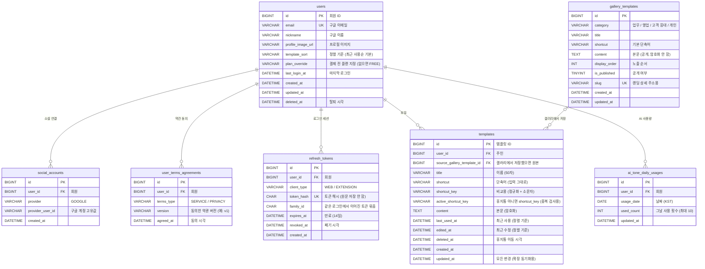

# SNIPTEXT ERD (S1 대시보드)

| 항목 | 내용 |
| --- | --- |
| 버전 | v0.7 (2026-10-31, 인증·회원 동작 반영) |
| v0.6 대비 | 설명만 보강: `users.profile_image_url`(500자 초과 시 저장 안 함), `users.last_login_at`(가입도 로그인으로 기록), `refresh_tokens.revoked_at`(재사용 감지 시 계보 폐기), 설계 메모 "가입"(인가 코드 방식). 테이블·컬럼·인덱스 변경 없음 |
| v0.5 → v0.6 | 같은 갤러리 템플릿 여러 번 저장 허용 → `source_gallery_template_id`는 출처 기록·집계용으로만 사용, 인덱스를 `(source_gallery_template_id)` 하나로 변경. 테이블·컬럼 변경 없음 |
| v0.4 → v0.5 | `user_terms_agreements` 추가(약관 버전별 동의 기록), `users.terms_agreed_at` 삭제 |
| DB | MySQL 8.4 / JPA |
| 문자셋 | utf8mb4 |
| 시간 | 모든 시각 컬럼은 KST 기준 `DATETIME(6)` |
| 범위 | S1 대시보드. 결제·구독은 기획 정책 확정 후 추가 (6장) |

## 1. 관계도



## 2. 테이블 목록

| 테이블 | 설명 | 비고 |
| --- | --- | --- |
| `users` | 회원 |  |
| `social_accounts` | 소셜 로그인 연결 |  |
| `user_terms_agreements` | 약관 동의 기록 | 약관 종류·버전별 1행. 약관 본문은 DB에 두지 않음 |
| `refresh_tokens` | 재발급 토큰 | Redis를 쓰면 이 테이블은 Redis로 대체 가능 |
| `gallery_templates` | 갤러리 템플릿 | 운영자가 DB에 직접 등록. 공개 데이터라 암호화하지 않음 |
| `templates` | 내 템플릿 (휴지통 포함) |  |
| `ai_tone_daily_usages` | AI 톤 교정 일일 사용량 | 날짜별 1행이라 자정 리셋 배치가 필요 없음. 원문·결과는 저장하지 않음 |

## 3. 테이블 명세

### 3-1. `users` — 회원

| 컬럼 | 타입 | NULL | 기본값 | 키 | 설명 |
| --- | --- | --- | --- | --- | --- |
| `id` | BIGINT | N |  | PK | 회원 ID |
| `email` | VARCHAR(255) | N |  | UK | 구글 계정 이메일 |
| `nickname` | VARCHAR(50) | N |  |  | 구글 계정 이름 그대로 (앞뒤 공백 제거, 50자 초과 시 자름, 비어 있으면 이메일 앞부분) |
| `profile_image_url` | VARCHAR(500) | Y |  |  | 구글 프로필 이미지. 없거나 500자를 넘으면 저장하지 않음(null) → 닉네임 첫 글자 아바타 |
| `template_sort` | VARCHAR(20) | N | RECENT_USED |  | 내 템플릿 정렬 기억 (RECENT_USED / RECENT_EDITED) |
| `plan_override` | VARCHAR(10) | Y |  |  | 결제 도입 전 임시: 값이 있으면 이 플랜(FREE/PRO)으로 판정. 테스트 계정을 Pro로 만들 때 사용 |
| `last_login_at` | DATETIME(6) | Y |  |  | 마지막 로그인 시각 (가입도 로그인으로 기록) |
| `created_at` | DATETIME(6) | N |  |  | 생성 시각 |
| `updated_at` | DATETIME(6) | N |  |  | 수정 시각 |
| `deleted_at` | DATETIME(6) | Y |  |  | 탈퇴 시각 (탈퇴 화면은 미정) |

- 유니크 `uk_users_email` (email)

### 3-2. `social_accounts` — 소셜 로그인 연결

| 컬럼 | 타입 | NULL | 기본값 | 키 | 설명 |
| --- | --- | --- | --- | --- | --- |
| `id` | BIGINT | N |  | PK | ID |
| `user_id` | BIGINT | N |  | FK | 회원 ID |
| `provider` | VARCHAR(20) | N |  |  | GOOGLE |
| `provider_user_id` | VARCHAR(100) | N |  |  | 구글 계정 고유값(ID 토큰의 sub) |
| `created_at` | DATETIME(6) | N |  |  | 연결 시각 |

- 유니크 `uk_social_provider_user` (provider, provider_user_id)
- 인덱스 `idx_social_user` (user_id)
- 외래키 `user_id` → `users.id` (삭제 시 CASCADE)

### 3-3. `refresh_tokens` — 재발급 토큰

> Redis를 쓰면 이 테이블은 Redis로 대체 가능

| 컬럼 | 타입 | NULL | 기본값 | 키 | 설명 |
| --- | --- | --- | --- | --- | --- |
| `id` | BIGINT | N |  | PK | ID |
| `user_id` | BIGINT | N |  | FK | 회원 ID |
| `client_type` | VARCHAR(20) | N |  |  | WEB / EXTENSION |
| `token_hash` | CHAR(64) | N |  | UK | 토큰 원문 대신 SHA-256 해시 저장 |
| `family_id` | CHAR(36) | N |  |  | 재발급 계보. 이미 쓴 토큰이 다시 오면 계보 전체 폐기 |
| `expires_at` | DATETIME(6) | N |  |  | 만료 시각 |
| `revoked_at` | DATETIME(6) | Y |  |  | 폐기 시각 (로그아웃·교체·재사용 감지 시 계보 폐기) |
| `created_at` | DATETIME(6) | N |  |  | 발급 시각 |

- 유니크 `uk_refresh_token_hash` (token_hash)
- 인덱스 `idx_refresh_user` (user_id)
- 인덱스 `idx_refresh_family` (family_id)
- 외래키 `user_id` → `users.id` (삭제 시 CASCADE)

### 3-4. `gallery_templates` — 갤러리 템플릿

> 운영자가 DB에 직접 등록. 공개 데이터라 암호화하지 않음

| 컬럼 | 타입 | NULL | 기본값 | 키 | 설명 |
| --- | --- | --- | --- | --- | --- |
| `id` | BIGINT | N |  | PK | 갤러리 템플릿 ID |
| `category` | VARCHAR(20) | N |  |  | WORK / SALES / CUSTOMER_SERVICE / PERSONAL |
| `title` | VARCHAR(50) | N |  |  | 제목 |
| `shortcut` | VARCHAR(11) | N |  |  | 기본 단축어 (/ 포함) |
| `content` | TEXT | N |  |  | 본문 |
| `display_order` | INT | N | 0 |  | 노출 순서 |
| `is_published` | TINYINT(1) | N | 1 |  | 공개 여부 |
| `slug` | VARCHAR(100) | Y |  | UK | S3 랜딩 상세 페이지 주소용 이름 |
| `created_at` | DATETIME(6) | N |  |  | 생성 시각 |
| `updated_at` | DATETIME(6) | N |  |  | 수정 시각 |

- 유니크 `uk_gallery_slug` (slug)
- 인덱스 `idx_gallery_category` (is_published, category, display_order)

### 3-5. `templates` — 내 템플릿 (휴지통 포함)

| 컬럼 | 타입 | NULL | 기본값 | 키 | 설명 |
| --- | --- | --- | --- | --- | --- |
| `id` | BIGINT | N |  | PK | 템플릿 ID |
| `user_id` | BIGINT | N |  | FK | 회원 ID |
| `source_gallery_template_id` | BIGINT | Y |  | FK | 갤러리에서 저장한 경우 원본 ID. 출처 기록·집계용 (같은 원본 여러 번 저장 가능) |
| `title` | VARCHAR(50) | N |  |  | 이름. 앞뒤 공백 제거 후 1~50자 |
| `shortcut` | VARCHAR(11) | N |  |  | 표시용 단축어. / 포함, 입력한 대소문자 그대로 (/Quote) |
| `shortcut_key` | VARCHAR(11) | N |  |  | 비교용 단축어. NFC 정규화 + 소문자 (/quote) |
| `active_shortcut_key` | VARCHAR(11) (생성 컬럼) | Y |  |  | 생성 컬럼. 휴지통이면 NULL → 단축어 점유 해제 |
| `content` | TEXT | N |  |  | 본문 3000자. 서버에서 암호화해 저장 |
| `last_used_at` | DATETIME(6) | Y |  |  | 최근 사용 시각 → 최근 사용순 정렬, 확장 팝업 최근 사용 5개 |
| `edited_at` | DATETIME(6) | N |  |  | 제목·단축어·본문을 고친 시각 → 최근 수정순. 사용 기록으로는 안 바뀜 |
| `deleted_at` | DATETIME(6) | Y |  |  | 휴지통 이동 시각. 30일 뒤 배치로 영구 삭제 |
| `created_at` | DATETIME(6) | N |  |  | 생성 시각 |
| `updated_at` | DATETIME(6) | N |  |  | 모든 변경(사용 기록·삭제 포함) → 확장 동기화 기준 |

- 유니크 `uk_templates_user_active_shortcut` (user_id, active_shortcut_key)
- 인덱스 `idx_templates_user_deleted` (user_id, deleted_at)
- 인덱스 `idx_templates_user_updated` (user_id, updated_at)
- 인덱스 `idx_templates_gallery` (source_gallery_template_id): 외래키용 + 갤러리 템플릿별 저장 수 집계
- 인덱스 `idx_templates_deleted_at` (deleted_at)
- 외래키 `user_id` → `users.id` (삭제 시 CASCADE)
- 외래키 `source_gallery_template_id` → `gallery_templates.id` (삭제 시 SET NULL)

### 3-6. `ai_tone_daily_usages` — AI 톤 교정 일일 사용량

> 날짜별 1행이라 자정 리셋 배치가 필요 없음. 원문·결과는 저장하지 않음

| 컬럼 | 타입 | NULL | 기본값 | 키 | 설명 |
| --- | --- | --- | --- | --- | --- |
| `id` | BIGINT | N |  | PK | ID |
| `user_id` | BIGINT | N |  | FK | 회원 ID |
| `usage_date` | DATE | N |  |  | KST 기준 날짜 |
| `used_count` | INT | N | 0 |  | 그날 사용 횟수 |
| `updated_at` | DATETIME(6) | N |  |  | 수정 시각 |

- 유니크 `uk_ai_usage_user_date` (user_id, usage_date)
- 외래키 `user_id` → `users.id` (삭제 시 CASCADE)

### 3-7. `user_terms_agreements` — 약관 동의 기록

| 컬럼 | 타입 | NULL | 기본값 | 키 | 설명 |
| --- | --- | --- | --- | --- | --- |
| `id` | BIGINT | N |  | PK | ID |
| `user_id` | BIGINT | N |  | FK | 회원 ID |
| `terms_type` | VARCHAR(20) | N |  |  | SERVICE(이용약관) / PRIVACY(개인정보 수집·이용). 마케팅 동의가 생기면 MARKETING 추가 |
| `version` | VARCHAR(20) | N |  |  | 동의한 약관 버전 (예: v1). 현재 버전은 서버 설정값 |
| `agreed_at` | DATETIME(6) | N |  |  | 동의 시각 |

- 유니크 `uk_terms_user_type_version` (user_id, terms_type, version)
- 외래키 `user_id` → `users.id` (삭제 시 CASCADE)
- 가입 완료 시 SERVICE·PRIVACY 두 줄을 현재 버전으로 저장. 회원과 같은 트랜잭션
- 약관이 바뀌면 설정값의 버전만 올림. 로그인 때 "회원의 최신 동의 버전 < 현재 버전"이면 재동의 필요 (재동의 화면·API는 약관 변경이 생길 때 추가)

## 4. 설계 메모

| 주제 | 내용 |
| --- | --- |
| 단축어 중복 | `(user_id, active_shortcut_key)` 유니크. 휴지통이면 생성 컬럼이 NULL이 되어 점유 해제. 정규화(NFC + 소문자)는 앱에서 하고 컬럼은 이진 비교. JPA에서는 생성 컬럼을 `insertable = false, updatable = false`로 매핑 |
| 정렬 | 최근 사용순(`last_used_at`, 미사용은 뒤에 생성순)과 최근 수정순(`edited_at`) 2개. 사용 기록은 `edited_at`을 바꾸지 않아 최근 수정순이 흔들리지 않음 |
| 사용 기록 | 사용 횟수는 저장하지 않음(기획 확정). 복사·삽입 시 `last_used_at`만 갱신. 사용 통계는 분석 도구 이벤트로 확인 |
| 한도 검사 | 휴지통 제외 개수로 셈 (Free 5 / Pro 50). 생성·복구·갤러리 저장은 회원 행을 잠그고 검사 후 저장 |
| 현재 플랜 판정 | 결제 도입 전에는 `users.plan_override` 값, 없으면 FREE. 판정은 서비스 한 곳(현재 플랜 조회)에만 두고, 결제가 들어오면 그 안쪽만 구독 테이블 기준으로 바꿈 |
| AI 사용량 | 요청 시 `used_count < 10` 조건으로 1 올려 선점, AI 실패·타임아웃이면 1 되돌림 |
| 본문 암호화 | `templates.content`만 AES-GCM 암호화(JPA 변환기). DB 본문 검색은 하지 않음 |
| 상단 통합 검색 (DSH-09) | DB 변경 없음. 화면이 내 템플릿 전체 + 갤러리 전체를 받아서 검색 (본문 암호화 때문에 서버 검색 불가) |
| 카드 변수명 (MYT-05) | 컬럼 없음. 조회할 때 복호화한 본문에서 변수 정규식으로 뽑아 응답의 `variables`로 내려줌 |
| 카드 표시 변경 (MYT-05) | 최근 사용 시각은 카드에서 빠졌지만 `last_used_at`은 최근 사용순 정렬 기준이라 유지 |
| 가입 | 구글 로그인(인가 코드 교환 → ID 토큰 검증) → (처음 온 사용자) 약관 동의 화면 → 동의 시 회원 생성 + 소셜 계정 연결 + 약관 동의 기록 저장(한 트랜잭션). 동의 전에는 회원 정보를 저장하지 않음 |
| 탈퇴 (화면 미정) | 템플릿·토큰·AI 사용량 삭제. 약관 동의 기록 보존 기간은 탈퇴 정책 정할 때 같이 결정. 결제 도입 후에는 결제 기록 보존을 위해 `users`를 익명화하는 방식으로 변경 |
| 시간대 | KST로 저장하므로 서버(JVM)와 DB 접속 시간대를 `Asia/Seoul`로 고정해야 함 |
| PostgreSQL로 바꾸면 | 단축어 유니크를 부분 인덱스(`WHERE deleted_at IS NULL`)로, `DATETIME(6)`→`TIMESTAMP`, `TINYINT(1)`→`BOOLEAN`. 나머지 구조 동일 |

## 5. 배치 작업

| 시각 (KST) | 작업 |
| --- | --- |
| 매일 00:10 | 휴지통 30일 지난 템플릿 영구 삭제 |
| 매일 04:00 | 만료된 재발급 토큰 정리 |

## 6. 확정 사항과 나중에 추가할 것

| 항목 | 결정 | ERD 반영 |
| --- | --- | --- |
| 변수 타입 | 텍스트만 | 변수 테이블 없음, 본문에서 파싱 |
| 갤러리 저장 | 같은 템플릿 여러 번 저장 가능, 저장됨 표시 없음, 저장할 때마다 한도 한 칸 (기획 확정 10/17) | 유니크 제약 없음 |
| 템플릿 이름 | 50자 | `templates.title` VARCHAR(50) |
| 카테고리·태그 | 내 템플릿에는 없음 | 컬럼 없음 |
| 닉네임 | 구글 이름 그대로 | `users.nickname` |
| 약관 동의 | 첫 로그인 직후 필수 동의 1개 (마케팅은 필요해지면 추가) | `user_terms_agreements`에 약관 종류·버전별 기록 (팀 리뷰 반영) |
| 약관 본문·관리자 페이지 | 이번 범위 아님 | 본문은 랜딩의 버전별 정적 페이지(예: `/terms/v1`). 관리자 페이지가 생기면 그때 약관 테이블 추가 |
| 갤러리 출처 | 유지 (출처 기록·집계용) | `templates.source_gallery_template_id`. 내용은 복사만 하고 동기화하지 않음. 저장 수는 이 컬럼으로 집계 (`save_count` 컬럼 두지 않음) |
| 사용 횟수 | 제거 | `use_count` 없음, `last_used_at`만 유지 |
| 결제·구독 | 기획 정책 확정 후 | 나중에 `subscriptions`, `payments` 추가. 기존 테이블 변경 없음 |
| 해지 후 초과분 비활성 | 결제와 함께 | 나중에 `templates.status` 추가 (기본값 ACTIVE) |

## 부록. DDL (MySQL 8.4)

```sql
-- SNIPTEXT S1 ERD - MySQL 8.4 / v0.6 (2026-10-17, 갤러리 여러 번 저장 허용)
-- 시간 컬럼은 모두 KST 기준. 결제·구독 테이블은 PLN 정책 확정 후 추가

-- 회원
CREATE TABLE users (
    id                           BIGINT NOT NULL AUTO_INCREMENT COMMENT '회원 ID',
    email                        VARCHAR(255) NOT NULL COMMENT '구글 계정 이메일',
    nickname                     VARCHAR(50) NOT NULL COMMENT '구글 계정 이름 그대로 (앞뒤 공백 제거, 50자 초과 시 자름, 비어 있으면 이메일 앞부분)',
    profile_image_url            VARCHAR(500) NULL COMMENT '구글 프로필 이미지. 없으면 닉네임 첫 글자 아바타',
    template_sort                VARCHAR(20) NOT NULL DEFAULT 'RECENT_USED' COMMENT '내 템플릿 정렬 기억 (RECENT_USED / RECENT_EDITED)',
    plan_override                VARCHAR(10) NULL COMMENT '결제 도입 전 임시: 값이 있으면 이 플랜(FREE/PRO)으로 판정. 테스트 계정을 Pro로 만들 때 사용',
    last_login_at                DATETIME(6) NULL COMMENT '마지막 로그인 시각',
    created_at                   DATETIME(6) NOT NULL COMMENT '생성 시각',
    updated_at                   DATETIME(6) NOT NULL COMMENT '수정 시각',
    deleted_at                   DATETIME(6) NULL COMMENT '탈퇴 시각 (탈퇴 화면은 미정)',
    PRIMARY KEY (id),
    UNIQUE KEY uk_users_email (email)
) ENGINE = InnoDB DEFAULT CHARSET = utf8mb4 COLLATE = utf8mb4_0900_ai_ci COMMENT = '회원';

-- 소셜 로그인 연결
CREATE TABLE social_accounts (
    id                           BIGINT NOT NULL AUTO_INCREMENT COMMENT 'ID',
    user_id                      BIGINT NOT NULL COMMENT '회원 ID',
    provider                     VARCHAR(20) NOT NULL COMMENT 'GOOGLE',
    provider_user_id             VARCHAR(100) NOT NULL COMMENT '구글 계정 고유값(ID 토큰의 sub)',
    created_at                   DATETIME(6) NOT NULL COMMENT '연결 시각',
    PRIMARY KEY (id),
    UNIQUE KEY uk_social_provider_user (provider, provider_user_id),
    KEY idx_social_user (user_id),
    CONSTRAINT fk_social_user FOREIGN KEY (user_id) REFERENCES users (id) ON DELETE CASCADE
) ENGINE = InnoDB DEFAULT CHARSET = utf8mb4 COLLATE = utf8mb4_0900_ai_ci COMMENT = '소셜 로그인 연결';

-- 약관 동의 기록 : 어떤 회원이 어떤 약관의 어느 버전에 동의했는지. 약관 본문은 랜딩의 버전별 정적 페이지
CREATE TABLE user_terms_agreements (
    id                           BIGINT NOT NULL AUTO_INCREMENT COMMENT 'ID',
    user_id                      BIGINT NOT NULL COMMENT '회원 ID',
    terms_type                   VARCHAR(20) NOT NULL COMMENT 'SERVICE(이용약관) / PRIVACY(개인정보 수집·이용). 마케팅 동의가 생기면 MARKETING 추가',
    version                      VARCHAR(20) NOT NULL COMMENT '동의한 약관 버전 (예: v1). 현재 버전은 서버 설정값',
    agreed_at                    DATETIME(6) NOT NULL COMMENT '동의 시각',
    PRIMARY KEY (id),
    UNIQUE KEY uk_terms_user_type_version (user_id, terms_type, version),
    CONSTRAINT fk_terms_user FOREIGN KEY (user_id) REFERENCES users (id) ON DELETE CASCADE
) ENGINE = InnoDB DEFAULT CHARSET = utf8mb4 COLLATE = utf8mb4_0900_ai_ci COMMENT = '약관 동의 기록';

-- 재발급 토큰 : Redis를 쓰면 이 테이블은 Redis로 대체 가능
CREATE TABLE refresh_tokens (
    id                           BIGINT NOT NULL AUTO_INCREMENT COMMENT 'ID',
    user_id                      BIGINT NOT NULL COMMENT '회원 ID',
    client_type                  VARCHAR(20) NOT NULL COMMENT 'WEB / EXTENSION',
    token_hash                   CHAR(64) NOT NULL COMMENT '토큰 원문 대신 SHA-256 해시 저장',
    family_id                    CHAR(36) NOT NULL COMMENT '재발급 계보. 이미 쓴 토큰이 다시 오면 계보 전체 폐기',
    expires_at                   DATETIME(6) NOT NULL COMMENT '만료 시각',
    revoked_at                   DATETIME(6) NULL COMMENT '폐기 시각 (로그아웃·교체)',
    created_at                   DATETIME(6) NOT NULL COMMENT '발급 시각',
    PRIMARY KEY (id),
    UNIQUE KEY uk_refresh_token_hash (token_hash),
    KEY idx_refresh_user (user_id),
    KEY idx_refresh_family (family_id),
    CONSTRAINT fk_refresh_user FOREIGN KEY (user_id) REFERENCES users (id) ON DELETE CASCADE
) ENGINE = InnoDB DEFAULT CHARSET = utf8mb4 COLLATE = utf8mb4_0900_ai_ci COMMENT = '재발급 토큰';

-- 갤러리 템플릿 : 운영자가 DB에 직접 등록. 공개 데이터라 암호화하지 않음
CREATE TABLE gallery_templates (
    id                           BIGINT NOT NULL AUTO_INCREMENT COMMENT '갤러리 템플릿 ID',
    category                     VARCHAR(20) NOT NULL COMMENT 'WORK / SALES / CUSTOMER_SERVICE / PERSONAL',
    title                        VARCHAR(50) NOT NULL COMMENT '제목',
    shortcut                     VARCHAR(11) NOT NULL COMMENT '기본 단축어 (/ 포함)',
    content                      TEXT NOT NULL COMMENT '본문',
    display_order                INT NOT NULL DEFAULT 0 COMMENT '노출 순서',
    is_published                 TINYINT(1) NOT NULL DEFAULT 1 COMMENT '공개 여부',
    slug                         VARCHAR(100) NULL COMMENT 'S3 랜딩 상세 페이지 주소용 이름',
    created_at                   DATETIME(6) NOT NULL COMMENT '생성 시각',
    updated_at                   DATETIME(6) NOT NULL COMMENT '수정 시각',
    PRIMARY KEY (id),
    UNIQUE KEY uk_gallery_slug (slug),
    KEY idx_gallery_category (is_published, category, display_order)
) ENGINE = InnoDB DEFAULT CHARSET = utf8mb4 COLLATE = utf8mb4_0900_ai_ci COMMENT = '갤러리 템플릿';

-- 내 템플릿 (휴지통 포함)
CREATE TABLE templates (
    id                           BIGINT NOT NULL AUTO_INCREMENT COMMENT '템플릿 ID',
    user_id                      BIGINT NOT NULL COMMENT '회원 ID',
    source_gallery_template_id   BIGINT NULL COMMENT '갤러리에서 저장한 경우 원본 ID (출처 기록·집계용, 같은 원본 여러 번 가능)',
    title                        VARCHAR(50) NOT NULL COMMENT '이름. 앞뒤 공백 제거 후 1~50자',
    shortcut                     VARCHAR(11) NOT NULL COMMENT '표시용 단축어. / 포함, 입력한 대소문자 그대로 (/Quote)',
    shortcut_key                 VARCHAR(11) COLLATE utf8mb4_bin NOT NULL COMMENT '비교용 단축어. NFC 정규화 + 소문자 (/quote)',
    active_shortcut_key          VARCHAR(11) COLLATE utf8mb4_bin GENERATED ALWAYS AS (IF(deleted_at IS NULL, shortcut_key, NULL)) STORED COMMENT '생성 컬럼. 휴지통이면 NULL → 단축어 점유 해제',
    content                      TEXT NOT NULL COMMENT '본문 3000자. 서버에서 암호화해 저장',
    last_used_at                 DATETIME(6) NULL COMMENT '최근 사용 시각 → 최근 사용순 정렬, 확장 팝업 최근 사용 5개',
    edited_at                    DATETIME(6) NOT NULL COMMENT '제목·단축어·본문을 고친 시각 → 최근 수정순. 사용 기록으로는 안 바뀜',
    deleted_at                   DATETIME(6) NULL COMMENT '휴지통 이동 시각. 30일 뒤 배치로 영구 삭제',
    created_at                   DATETIME(6) NOT NULL COMMENT '생성 시각',
    updated_at                   DATETIME(6) NOT NULL COMMENT '모든 변경(사용 기록·삭제 포함) → 확장 동기화 기준',
    PRIMARY KEY (id),
    UNIQUE KEY uk_templates_user_active_shortcut (user_id, active_shortcut_key),
    KEY idx_templates_user_deleted (user_id, deleted_at),
    KEY idx_templates_user_updated (user_id, updated_at),
    KEY idx_templates_gallery (source_gallery_template_id),
    KEY idx_templates_deleted_at (deleted_at),
    CONSTRAINT fk_templates_user FOREIGN KEY (user_id) REFERENCES users (id) ON DELETE CASCADE,
    CONSTRAINT fk_templates_gallery FOREIGN KEY (source_gallery_template_id) REFERENCES gallery_templates (id) ON DELETE SET NULL
) ENGINE = InnoDB DEFAULT CHARSET = utf8mb4 COLLATE = utf8mb4_0900_ai_ci COMMENT = '내 템플릿 (휴지통 포함)';

-- AI 톤 교정 일일 사용량 : 날짜별 1행이라 자정 리셋 배치가 필요 없음. 원문·결과는 저장하지 않음
CREATE TABLE ai_tone_daily_usages (
    id                           BIGINT NOT NULL AUTO_INCREMENT COMMENT 'ID',
    user_id                      BIGINT NOT NULL COMMENT '회원 ID',
    usage_date                   DATE NOT NULL COMMENT 'KST 기준 날짜',
    used_count                   INT NOT NULL DEFAULT 0 COMMENT '그날 사용 횟수',
    updated_at                   DATETIME(6) NOT NULL COMMENT '수정 시각',
    PRIMARY KEY (id),
    UNIQUE KEY uk_ai_usage_user_date (user_id, usage_date),
    CONSTRAINT fk_ai_usage_user FOREIGN KEY (user_id) REFERENCES users (id) ON DELETE CASCADE
) ENGINE = InnoDB DEFAULT CHARSET = utf8mb4 COLLATE = utf8mb4_0900_ai_ci COMMENT = 'AI 톤 교정 일일 사용량';
```
